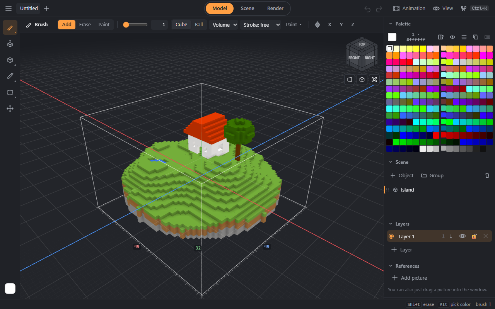

# DamnVoxel

A voxel model editor that runs in the browser — on a desktop, a tablet or a phone. It reads and writes MagicaVoxel `.vox` files without loss, installs as an app and works offline.



## Features
- **Drawing:** a brush (volume, plane, surface, pen pressure), face extrude, shapes from a box to a torus and an arch, smooth SDF shapes, curves, stamps, sculpting, fills, a live mirror, slicing, and “adjust last operation” for every step.
- **Selection:** rectangle, lasso, box and magic wand; move with rotation by any angle and scaling, arrays, named sets, editing only inside (or outside) the selection.
- **Scene:** objects, groups, layers, linked copies, booleans, arranging, an asset library, reference pictures; ropes, chains and cloth with physics.
- **Color:** a 256-color palette with ramps, names and a palette library; painting with gradients, noise and splatter; MagicaVoxel materials.
- **Animation:** model frames and position keys, smooth motion, onion skin.
- **Render:** path tracing with materials, sky, HDR panoramas, fog and depth of field; a render window over editing; frames up to 8192 px, turntables and animations as GIF or video, isometric sprite sheets.
- **Programs:** build shapes from JavaScript or from a node graph, with live parameters.
- **Files:** lossless `.vox`, tabs, autosave, version history, recovery of damaged files; export to glTF / GLB, OBJ, PLY and STL; voxelize glTF / OBJ / STL; pictures and PNG slices in and out.
- **Input:** mouse, touchpad, finger and pen as equals; MagicaVoxel, Blockbench and Blender key layouts, every key remappable; a command palette, a radial menu, light and dark themes.

## Getting started
You need [Node.js](https://nodejs.org/) 22.12 or newer and [pnpm](https://pnpm.io/) 10.

```sh
pnpm install
pnpm dev
```

Then open http://localhost:5173. Add `?demo` to the address to start with the example island; `?stats` shows frame statistics and `?bench` runs a benchmark on your device. On Windows, `start-dev.bat` does the same in one click.

For a production build, `pnpm build` writes a static site to `dist/` (with the user guide under `/guide/`) and `pnpm preview` serves it. The build works from any path, so any static host will do.

## Documentation
- **[User guide](docs/user/README.md)** — how to use the editor. It is also built into the app: “☰ → Help”.
- **[Technical documentation](docs/README.md)** — architecture, data model, rendering, file formats, programs, benchmarks.
- **[Contributing](CONTRIBUTING.md)** — setting up, checks, and how changes are made.

## Development

| Command | What it does |
|---|---|
| `pnpm dev` | the dev server |
| `pnpm build` / `pnpm preview` | a production build with the guide, and a preview of it |
| `pnpm test`, `pnpm test:coverage` | tests, with coverage thresholds for the core |
| `pnpm lint`, `pnpm check` | lint and layer rules, type checks |
| `pnpm format` | format the code with Biome |
| `pnpm size` | the bundle size against its budget |
| `pnpm bench:mesher` | the meshing benchmark in Node |
| `pnpm fixtures:vox`, `pnpm samples:vox` | the `.vox` test corpus, and files for checking by hand in MagicaVoxel |

## License
- The editor is licensed under the [GNU AGPL-3.0-or-later](LICENSE) (full text in [COPYING](COPYING)). You may use, change and share it; if you run a modified version as a website or a service, you must publish your changes.
- The file format code in [`src/formats`](src/formats) (`.vox` chunks, glTF/GLB, OBJ, PLY, STL, GIF, PNG, ZIP, `.hdr`, palettes) is under the [MIT licence](src/formats/LICENSE), so other tools — open or closed — can support the same formats. It imports nothing from the editor; the build checks that.
- The format description in [docs/formats.md](docs/formats.md) is under [CC BY 4.0](https://creativecommons.org/licenses/by/4.0/).
- Third-party data: see [NOTICE](NOTICE).

DamnVoxel is not affiliated with MagicaVoxel. The `.vox` format and the default palette are by ephtracy; the palette is used under the MIT licence of `ephtracy/voxel-model` (see `NOTICE`).
