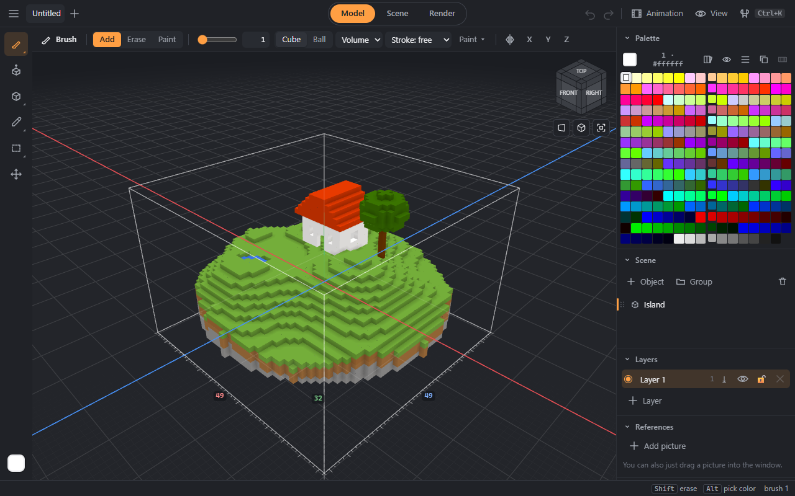

# DamnVoxel — guide

DamnVoxel is a voxel model editor in the browser: draw with cubes, build scenes, animate, render beautifully and send models to games, 3D printers and other programs. It works on a computer, a tablet and a phone, installs as an app and then works offline. Files are `.vox`, as in MagicaVoxel: models open there and back.

## Where to start
Open **☰ → Examples…** — there are five ready scenes: an island, materials for the render, a village with layers, a bouncing ball and a small character. Each opens in its own tab; your documents do not change. Then — [getting started](start.md).

## Chapters
1. [Getting started](start.md) — the window, modes, camera, undo, saving.
2. [Drawing and shaping](drawing.md) — brush, shapes, face, stamp, sculpt, fill, smooth shapes, curves, mirror.
3. [Selecting and moving](selection.md) — select, move, rotate, scale, sets.
4. [Scene](scene.md) — objects, groups, layers, linked copies, booleans, library, references, ropes and cloth.
5. [Color and materials](color.md) — the palette, ramps, painting with patterns, materials.
6. [Animation](animation.md) — frames, keys, onion skin.
7. [Render](render.md) — light, materials, the render window, large frames, GIF and video, sprites.
8. [Programs](programs.md) — shapes from code and nodes.
9. [Files](files.md) — `.vox`, autosave, versions, recovery, mesh export, voxelization, pictures and slices.
10. [Keys](keys.md).

## If something goes wrong
- Everything can be undone: **Ctrl+Z**, on a phone — a two-finger tap.
- Unsaved work is written to the browser every couple of seconds; after a crash the editor offers to bring it back.
- **☰ → Version history…** keeps snapshots of the document on every save and every 10 minutes of work.
- A damaged `.vox` opens with whatever survived — as a new document.
