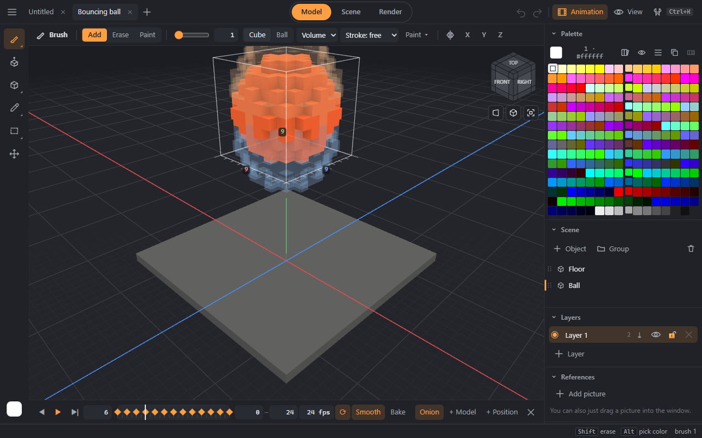

# Animation

The **Animation** button at the top (or **Alt+A**) opens the timeline.

- **Frames:** the frame number, play (**Alt+/**), step forward and back (**Alt+. / Alt+,**), the range and frame rate, loop.
- **Model keys:** “+ Model” remembers the object's voxels on this frame — then draw the next frame. As in MagicaVoxel.
- **Position keys:** “+ Position” remembers where the object stands; moving an animated object in the scene sets a key by itself. “Smooth” glides the object between keys; without it the position holds until the next key; “Bake” writes the smooth motion as a key on every frame — that is how MagicaVoxel will see it.
- **Onion skin:** the neighbouring frames shown faded — the previous one in blue, the next one in orange.
- Animation is written to `.vox` (model frames and positions). GIF and video come from the [render](render.md#frame-series).
