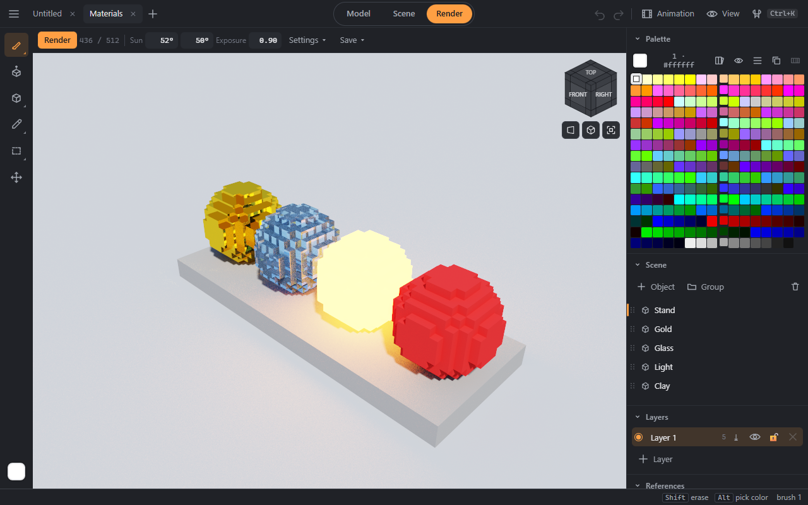

# Color and materials

## Palette
256 cells, as in MagicaVoxel. A click makes a color current, a double click opens the editor (HSV, RGB, hex). Cells are reordered by dragging and duplicated, and a gradient is built between two selected ones.
- Highlighting shows where a color is used, counters show how many voxels; colors can have names and rows can have notes; there is a list view.
- **Ramps** are rows of 8 colors from dark to light: **. ,** — the neighbouring color of the ramp, **Shift+. / Shift+,** — the same place in the neighbouring ramp.
- **Palette library**: built-in palettes, your own, import and export in GIMP `.gpl`, `.hex`, `.pal`, Photoshop `.act`, PNG and from `.vox`.

## Painting with patterns
The Paint menu in the bar of drawing tools: a solid color, a gradient along an axis, noise (random, Perlin, Worley, Voronoi), splatter — the colors come from the ramp. A tone shift makes voxels lighter or darker — by the palette ramp or by HSL. **Color lock (Alt+L)** changes only the voxels of the chosen colors.

## Materials
Every color has a MagicaVoxel material: matte, metal (metalness, roughness), glass (transparency, refraction), glow (strength), blend. The material editor is under the color editor. Materials show in the [render](render.md), are written to `.vox` and go to glTF as PBR.

