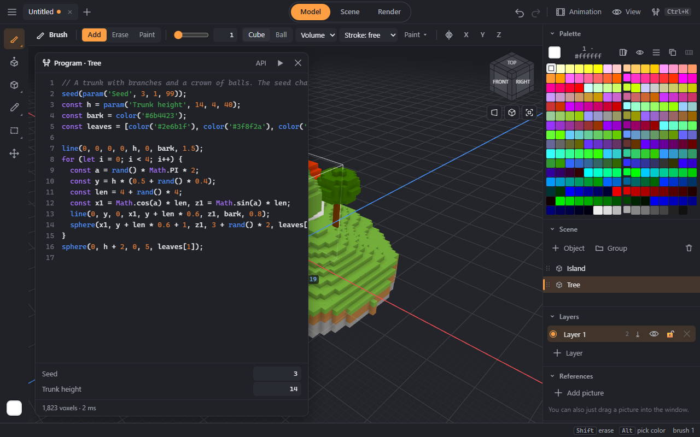
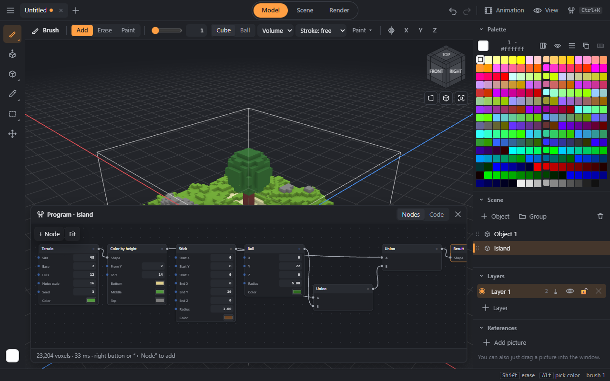

# Programs: shapes from code and nodes

A shape does not have to be drawn — it can be described by an algorithm: a tower of the right height, a tree of random branches, terrain from noise, a fractal. The program becomes a scene object; its parameters are sliders, and the object rebuilds on every edit.

Open **☰ → New program** or the **Program** button in Scene mode and choose where to start: a node template or a code template.

## With code


The code is JavaScript with a set of commands for voxels. Pause while typing — and the object is rebuilt; **Ctrl+Enter** — at once. An error shows at the bottom with its line, the line number turns red, and the model stays as it was while you finish the line. The **API** button shows every command.

```
const h = param('Height', 24, 6, 80);    // a slider from 6 to 80
const stone = color('#8a8a8a');          // the nearest palette color
cylinder(0, 0, 0, 6, h, stone);           // stands on the point, height h
cone(0, h, 0, 7, 8, color('#b03a2e'));
```

| Command | What it does |
|---|---|
| `param(name, value, min, max, step)` | a slider under the code; returns its value |
| `color('#rrggbb')`, `color(r, g, b)`, `palette(n)` | a palette color index |
| `set(x, y, z, c)`, `get`, `erase` | one voxel |
| `box(x0, y0, z0, x1, y1, z1, c)` | a box, corners inclusive |
| `sphere`, `ellipsoid`, `cylinder`, `cone`, `torus`, `line` | solids; a line can have a radius |
| `fill(x0, y0, z0, x1, y1, z1, (x, y, z) => c)` | every cell gets what the function returns |
| `shape((x, y, z) => d, c, x0, y0, z0, x1, y1, z1)` | signed distances: the cells where d ≤ 0 |
| `sd.sphere / box / cylinder / torus / capsule`, `sd.smoothUnion(a, b, k)`… | distances and their combinations, smooth seams |
| `noise`, `fbm`, `rand`, `seed` | Perlin noise, random numbers with a seed |
| `lerp`, `clamp`, `smoothstep`, `ramp(t, [colors])`, `log` | helpers and the log |

A program runs in a separate thread: an endless loop will not hang the editor — after 5 seconds it is stopped.

## With nodes


Nodes are the same thing without code: shapes (ball, box, cylinder, torus, cone, stick, terrain), combinations (union, subtract, intersect, blend, carve), transforms (move, rotate, scale, mirror, repeat, twist, bumps), color (recolor, by height, spots) and numbers. Everything flows into the **Result** node.

- Drag a wire from the point on the right of a title to an input point. Drag a connected input — the wire comes off and follows the mouse.
- A **Parameter** node gives a slider; its wire can go into any number field — into a height and a radius at once, for example.
- The right button or **+ Node** — add; the title — move; × — delete; the background — pan, the wheel — zoom, **Fit** — show everything.
- The **Code** tab shows what the nodes compiled into; “Edit as code” unlinks the program from the nodes.

## Also important
- Every edit is one undo step while you type or drag; undo brings back both the code and the nodes.
- The program is stored in the `.vox` file with the object and rebuilds in the same place after opening. MagicaVoxel shows its voxels as an ordinary model.
- A copy of the object takes the program along.
