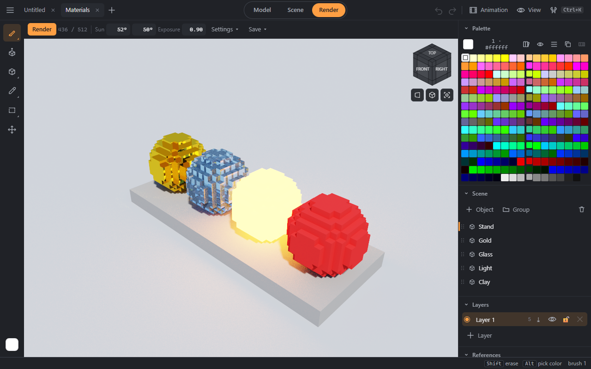
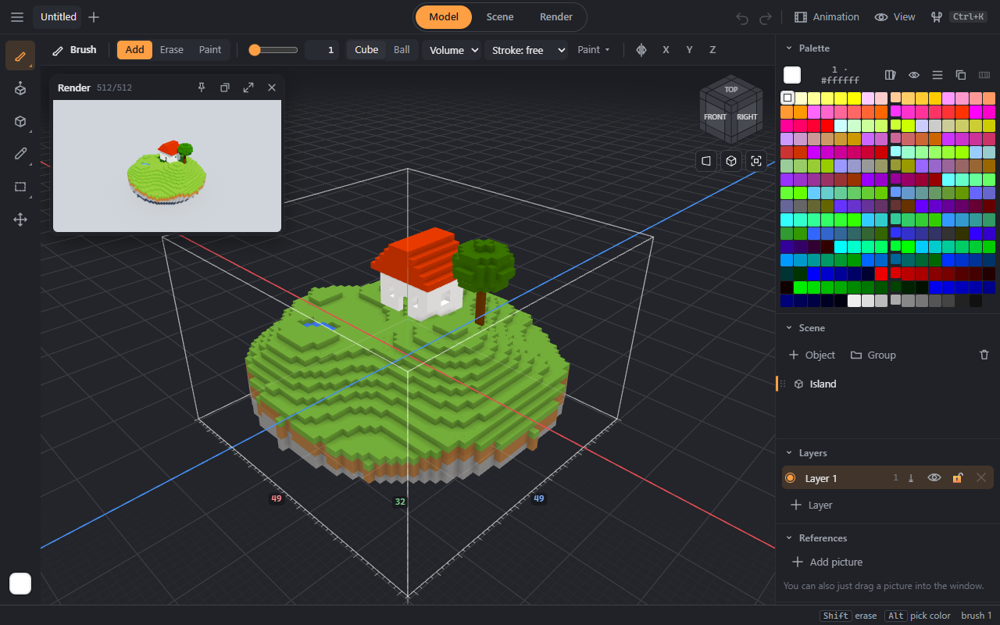

# Render

The **Render** mode computes the picture by ray tracing: soft shadows, reflections, glass, glow. The picture gets cleaner with every pass; the counter at the top shows the samples.

## Light and camera
- In the bar — the sun (turn and height) and the exposure; **Settings ▾** — samples, bounces, sun strength and size, sky and ground, fog, an `.hdr` sky panorama.
- **Camera and film:** depth of field (the lens radius and the focus; a click on the model sets the focus there), bloom of bright spots, the ACES film curve, denoising.

## Render window
**View → Render window over editing** — the traced picture in a small window while you draw: it catches up with your edits several times a second. Drag the window by its title, resize it, and pin its view so you can keep turning the camera.

## Saving a frame
**Save ▾ → Frame:** a PNG of any size up to 8192 on a side — as the view, 1080p, 4K, a square or your own; “Transparent background” keeps only the model. A large frame is computed in tiles while you keep working; the progress shows in the bar or as a badge over the view, and the file downloads by itself.

## Frame series
**Save ▾ → Frame series:**
- **Turntable** — the camera goes around the model in N frames; “the light turns with the camera” — like a model on a stand under studio lights.
- **Animation** — the timeline frames at its frame rate.
- **GIF** or **video** (MP4 or WebM — whatever the browser can do).
- **Sprites** — the model from 4 or 8 sides with an orthographic camera, a 2:1 tilt (pixel art) or isometric, a cell of the size you need, “pixelated” — no edge smoothing, animation frames as rows; a transparent background, all in one PNG sheet.
