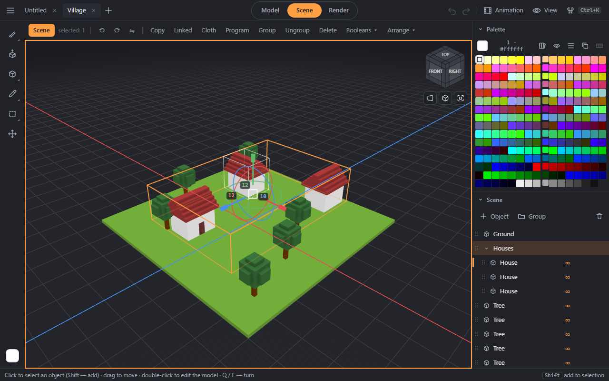

# Scene

## Objects and groups
- The scene tree in the dock: the name is edited in place, the eye hides, the lock locks, dragging changes the order and the group.
- **Shift+N** — a new object, **Ctrl+G / Ctrl+Shift+G** — group / ungroup.
- In **Scene** mode (Tab): a click selects an object, a drag moves it, the gizmo handles move along an axis and turn, a double click edits the model. The position and rotation numbers are in the bar.
- **End** puts the selection on the ground; “Arrange” aligns and spreads objects; the pivot can be set.
- An object's size is unlimited: larger than 256 on a side, it is split into pieces when written to `.vox`.

## Layers
At the bottom of the dock: the dot — the layer for new objects, the eye hides the whole layer, the lock locks it, ⤓ — move the selected objects onto the layer. Layers are saved in `.vox`.

## Linked copies
**Alt+D** — a copy that shares its voxels with the original: edit one and all of them change (the ∞ mark in the tree). “Unlink” makes the copy independent.

## Booleans
Merge, subtract, intersect objects; split an object into unconnected parts.

## Library
“Save selection” puts a piece with its colors and a thumbnail into browser storage — it is available in any document. A click inserts it as an object on the ground, “Stamp” takes it as a brush.

## References
A picture (with the button or by dragging it into the window) stands as a plane in the scene — at the front, side or top — or as a background behind the model; opacity, size, lock. References live in the tab and are not written to the file.

## Ropes and cloth
A rope, chain or cable — the **Shift+J** tool; its settings can be changed later. “Cloth” in Scene mode drapes a sheet over the selected objects — it settles by physics.
