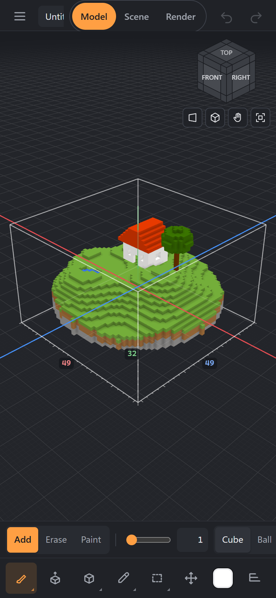

# Getting started

## The window
- **At the top:** the ☰ menu (files, examples, versions, keys, help), document tabs, undo and redo, the mode switch **Model · Scene · Render**, the Animation and View buttons, all commands (**Ctrl+K**).
- **On the left** — the tools. A button with a corner mark is a family: a click takes the last variant, a long press or the right button opens the list.
- **Above the canvas** — the settings bar of the current tool: what it does, size, shape, modes, mirror.
- **On the right** — palette, scene, layers, references, library; the sections collapse, the dock's edge can be dragged.
- **At the bottom** — what the tool will do and which modifier keys work right now.

Everything in the menus and buttons is also in the **commands** (Ctrl+K or F1): start typing a name.

## Modes
- **Model** — edit the voxels of the selected object.
- **Scene** — select, move and turn whole objects (Tab switches Model ↔ Scene). The view frame is highlighted.
- **Render** — a beautiful picture with light and materials; the camera turns, the tools rest. More in [Render](render.md).

## Camera
| | Mouse | Touchpad | Finger |
|---|---|---|---|
| Orbit | right button | two fingers | two fingers |
| Pan | middle button | Shift + two fingers | three fingers |
| Zoom | wheel | pinch | pinch |

**F** — frame the model, **Home** — the whole scene, the cube in the corner — front, side and top views. On the numpad: 1, 3, 7 — views, 5 — perspective / orthographic. A mouse and key layout like MagicaVoxel, Blockbench or Blender is chosen in **☰ → Keys and mouse**.

## Phone and tablet

The tools are at the bottom, under the thumb; the palette and the scene open as sheets. One finger is the tool, two the camera, a two-finger tap undoes, three fingers redo. A pen understands pressure: a light touch draws smaller. The “camera only” button by the view cube turns your finger into a camera.

## Undo and saving
- **Ctrl+Z / Ctrl+Shift+Z** — undo / redo; the steps are unlimited and everything is undone: voxels, palette, scene, selection.
- **Ctrl+S** saves to `.vox`. In Chrome and Edge — straight into the opened file; in other browsers a copy downloads.
- While work is unsaved, its tab shows a dot and a copy is written to the browser — after a crash it can be brought back.

## Adjust last operation
After a shape, a stamp, a fill and other operations, a panel with their numbers appears in the bottom left: change the size, the count or the radius — the operation is recomputed as a single undo step.

## Number fields
Drag sideways to change the value (Shift — faster, Ctrl — finer); click to type; they understand expressions: `2*8+1`, and `+5` or `*2` change the current value. A double click resets to the default.
